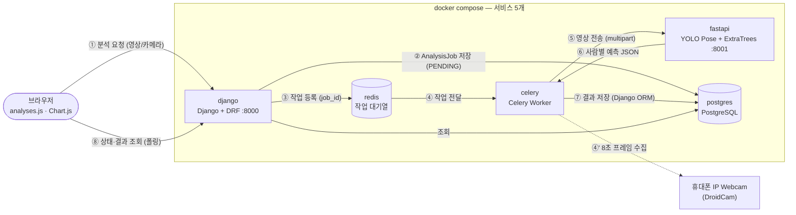
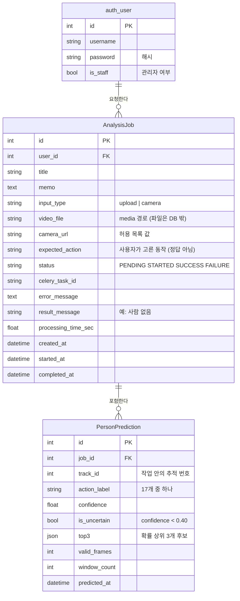
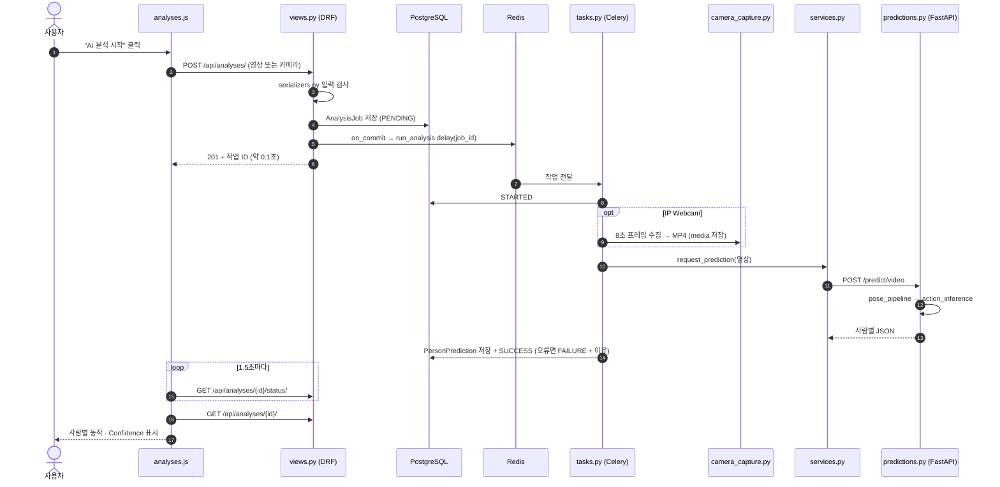

# Vision Action Platform

팀(team17)이 **5명 × 17개 동작**을 직접 촬영해 6일차 과정으로 학습한 **동작 인식 모델(ExtraTrees)** 을 재학습 없이 재사용해, 브라우저에서 AI 분석을 요청하고 결과를 DB에 저장·조회하는 Vision AI 웹 서비스입니다.

---

## 1. 프로젝트 소개

- **해결하는 문제:** 키오스크 두드리기·밀치기·넘어지기 같은 동작을 영상으로 받아, 영상 속 **사람마다** 어떤 동작인지 예측하고 기록으로 남깁니다.
- **지원 입력:** ① **영상 업로드**(MP4 등) ② **IP Webcam**(휴대폰 DroidCam에서 **8초** 수집)
- **사용자가 보는 결과:** 작업 상태(대기 → 처리 중 → 완료/실패), 사람별 **Track ID · 동작 · Confidence · 다음 후보 2개**, 낮은 Confidence는 **"판단 불확실"** 표시, 최근 분석 이력·상세(영상 재생)
- **관리자:** Django Admin(전체 작업·결과 검색·필터) + `/dashboard/`(17개 동작별 예측 건수·상태별 작업 건수 차트)

| 번호 | 동작 | action_label | 번호 | 동작 | action_label |
|---|---|---|---|---|---|
| A001 | 키오스크 두드리기 | `kiosk_tap` | A010 | 뒤로 눕기 | `lie_backward` |
| A002 | 한손 물건 던지기 | `throw_one_hand` | A011 | 몸통 박치기 | `body_slam` |
| A003 | 앞차기 | `front_kick` | A012 | 쪼그려 물건 빼내기 | `crouch_take_item` |
| A004 | 잡고 흔들기 | `grab_shake` | A013 | 샷건 | `shotgun` |
| A005 | 밀치기 | `push` | A014 | 구토 | `vomit` |
| A006 | 휘두르기 | `swing` | A015 | 옆으로 쓰러지기 | `fall_sideways` |
| A007 | 바닥에 앉기 | `sit_floor` | A016 | 뒤로 넘어지기 | `fall_backward` |
| A008 | 위에 앉기 | `sit_on_object` | A017 | 앞으로 넘어지기 | `fall_forward` |
| A009 | 앞으로 눕기 | `lie_forward` | | | |

> 학습하지 않은 동작에도 17개 중 하나가 출력될 수 있습니다. **예측 Label을 정답이나 위험행동 판정으로 단정하지 말고 Confidence와 함께** 보세요.

---

## 2. 실행 방법

### 준비
```bash
git clone <저장소 주소> vision_action_platform && cd vision_action_platform
cp .env.example .env          # 비밀번호·SECRET_KEY·카메라 주소를 실제 값으로 수정
```
- **모델 파일 위치:** `ai_service/models/` (저장소에 포함, 약 34MB)
  - `team17/clip_model.joblib`, `team17/hybrid_info.json`, `team17/action_classes.csv` ← 팀 학습 결과 `artifacts/team17/best_model/`
  - `yolo11n-pose.pt` ← YOLO Pose 가중치
  - `day06_baseline/` ← 처음에 연결했던 공통 6개 동작 모델 (보관용, 사용 안 함)
- **IP Webcam:** `.env` 의 `ALLOWED_CAMERA_URLS` 에 휴대폰 DroidCam 주소(`http://<휴대폰IP>:4747/video`)를 넣습니다. 여기 있는 카메라만 선택할 수 있습니다.

### Docker Compose (5개 서비스 한 번에)
```bash
docker compose up -d --build                         # 빌드 + 실행 (migrate 자동)
docker compose ps                                    # 5개 서비스 Up 확인
docker compose exec django python manage.py createsuperuser   # 관리자 계정
```

| 화면 | 주소 |
|---|---|
| 사용자 (회원가입·로그인·분석) | http://localhost:8080/ |
| 관리자 대시보드 | http://localhost:8080/dashboard/ |
| Django Admin | http://localhost:8080/admin/ |
| FastAPI Swagger (개발용) | http://localhost:8001/docs |

> 포트는 `.env` 의 `WEB_PORT`, `AI_PORT` 로 바꿀 수 있습니다.
> Docker 안의 FastAPI 는 **CPU** 로 추론합니다 (torch CPU 버전, 이미지 크기 절약). 영상 1건 약 1~25초 (60fps·고해상도일수록 김). 로컬 개발(GPU)은 1~3초.
> ⚠️ Compose 의 `celery` 가 켜져 있을 때 로컬 개발 서버(아래)로 작업을 만들면, 컨테이너 Worker 가 가져가서 영상 파일을 찾지 못합니다. 둘 중 하나만 실행하세요 (`docker compose stop django celery fastapi`).

### 로컬 개발 (가상환경, 터미널 3개)
```bash
docker compose up -d postgres redis                                   # DB·큐만 컨테이너
cd ai_service && uv venv --python 3.12 && uv pip install -r requirements.txt && uvicorn main:app --port 8001
cd backend && uv venv --python 3.12 && uv pip install -r requirements.txt
python manage.py migrate && python manage.py createsuperuser
celery -A config worker -l info --concurrency 1                       # 터미널 2
python manage.py runserver                                            # 터미널 3 (.env DJANGO_PORT)
```

### 테스트
```bash
cd backend && python manage.py test accounts analyses      # 31개
cd ai_service && python scripts/check_models.py            # 모델 3파일 로드·Class·Feature 확인
```

---

## 3. 전체 아키텍처



| 서비스 | 역할 | 하지 않는 일 |
|---|---|---|
| **django** | 회원·권한, DRF CRUD, 분석 요청 접수, 화면·대시보드, ORM | AI 추론 |
| **celery** | 큐에서 작업 꺼냄 → 영상 확보(업로드 파일/카메라 8초) → FastAPI 호출 → **ORM으로 저장** | 화면 렌더링 |
| **fastapi** | 영상 → YOLO Pose·사람별 추적 → team17 Feature 363개 → ExtraTrees → 사람별 JSON | DB·회원 (DB에 직접 접근하지 않음) |
| **redis** | Celery 메시지 브로커 (대기열) | 영구 저장 |
| **postgres** | 사용자·작업·사람별 결과 영구 저장 (볼륨) | — |

- 컨테이너 사이 주소는 **서비스 이름** (`postgres:5432`, `redis:6379`, `http://fastapi:8001`)
- 업로드 영상은 `media` **공유 볼륨** (django 저장 → celery 읽기), FastAPI에는 HTTP로 파일 전송

---

## 4. DB 설계 (ERD)



| 테이블 | 저장하는 것 | 위치 |
|---|---|---|
| `auth_user` | 회원 (Django 기본 User) | Django 제공 |
| `AnalysisJob` | 분석 요청 1건과 진행 상태 | `backend/analyses/models.py` |
| `PersonPrediction` | 그 작업 속 **사람 1명**의 예측 → 두 사람이면 작업 1건에 2행 | `backend/analyses/models.py` |

- `(job, track_id)` 유일 제약, 작업 삭제 시 사람별 결과도 삭제(CASCADE)
- 상태·예측값은 **읽기 전용** (사용자는 제목·메모만 수정)

---

## 5. AI 추론 버튼 구현 흐름



| 단계 | 대표 파일 |
|---|---|
| 화면·요청·폴링 | `backend/static/js/analyses.js`, `templates/analyses/index.html` |
| 입력 검사·작업 생성·큐 등록 | `backend/analyses/serializers.py`, `views.py` |
| 비동기 처리·저장 | `backend/analyses/tasks.py`, `services.py`, `camera_capture.py` |
| AI 추론 | `ai_service/routers/predictions.py`, `services/pose_pipeline.py`, `services/action_inference.py`, `services/model_loader.py` |
| 대시보드 | `backend/analyses/page_views.py`, `static/js/dashboard.js` |

---

## 6. 사용한 모델과 입력 형식

| 항목 | 내용 |
|---|---|
| 동작 분류 모델 | `team17/clip_model.joblib` — **ExtraTrees** (500 trees), **17개 동작**, **재학습 없음** |
| 학습 데이터 | 팀 5명(S01~S05) × 17동작 × **촬영 4가지 = 영상 340개** — 실제 촬영 **T01 정면 · T02 옆 · T03 뒤** + **T04 = T02(옆) 좌우반전 증강** |
| Feature | **363개** (`hybrid_info.json` 의 `clip_feature_names` 순서) — 몸통 길이로 정규화한 관절 좌표·관절각·골반 이동·몸 기울기·손목/코 속도의 **영상 전체 통계**(평균·표준편차·최소·최대·10/90%) + 손목·발목 최대 속도, 방향 전환 횟수, 넘어지는 속도 등 요약값 + 영상 길이 |
| Pose 모델 | `yolo11n-pose.pt` (COCO 17 Keypoint), 프레임 긴 변 960px, 40fps 넘으면 2프레임마다 |
| 사람 구분 | 직전 위치와 가까운 사람에게 같은 `track_id` (1초 넘게 안 보이면 새 ID), 가장 오래 보인 사람의 15% 미만만 잡힌 사람은 제외 |
| 전처리 코드 | 팀 원본 `team17_day06_train.py`·`team17_window_model.py`·`team17_ip_webcam_test.py` 의 함수를 **그대로 복사** → `ai_service/src/team17_features.py`, `team17_tracking.py` (`scripts/build_team17_features.py` 로 원본에서 재생성) |
| 업로드 형식 | `.mp4 .avi .mov .mkv .webm`, 최대 200MB, 동작 1번이 담긴 짧은 영상 권장 |
| IP Webcam | 허용된 DroidCam 주소에서 **준비 5초 → 8초** 수집 (`CAMERA_PREPARE_SECONDS`, `CAMERA_CAPTURE_SECONDS`), 화면 회전 `CAMERA_ROTATION` |
| IP Webcam 판단 보정 | 녹화가 항상 8초라서 사람마다 **움직인 구간만** 판단 (`/predict/video?trim_idle=true`) — 학습 영상은 동작 구간만 잘라 둔 것이고 영상 길이도 Feature 라서, 앞뒤 가만히 있는 시간이 길면 짧은 동작(앞차기 3.2초)이 긴 동작(위에 앉기 7초)으로 기움. 사람 신뢰도 0.5 미만(옷걸이 겉옷 등)은 제외 |
| 밀치기 ↔ 잡고 흔들기 보정 | 모델 1·2위가 이 두 동작일 때만 **팔꿈치를 접었다 편 횟수**로 결정 (3.5회 이상 = 잡고 흔들기). 팀 교차검증(학습에 안 쓴 사람)에서 밀치기 80% → 87%, 잡고 흔들기 53% → 60%, 전체 85.1% → 85.9% (`ai_service/services/rules.py`, 재학습 없음). 화면에 보정 이유 표시 |
| 실시간 미리보기 | IP Webcam 탭을 고르면 카메라 화면이 바로 보이고, 녹화 중에는 **● REC N초** 표시. DroidCam 은 동시 접속 1개라서 **Django 카메라 중계**(`analyses/camera_relay.py`)가 카메라에 한 번만 연결해 미리보기(브라우저)와 녹화(Worker)에 같은 화면을 나눠 줌 (Worker 는 `CAMERA_RELAY_TOKEN` 으로 접근) |
| 판단 불확실 | Confidence **< 0.40** (`UNCERTAIN_CONFIDENCE`, 팀 분석 기준과 같음) |

> **joblib 하나로는 영상을 분류할 수 없습니다.** 모델은 숫자 363개만 받으므로, 영상에서 관절을 찾고 학습 때와 **같은 함수**로 Feature를 만들어야 합니다. 그래서 팀 학습 코드를 그대로 가져왔고, scikit-learn(1.9.1) 등 버전을 학습 환경과 맞췄습니다.
> 검증: 원본 팀 코드(`team17/server.py` 방식)와 플랫폼 FastAPI 결과를 영상 7개(두 사람 영상 포함)로 비교 → **track_id·동작·Confidence 7/7 완전히 같음**

**FastAPI 입출력** — `POST /predict/video` (multipart `file`)
```json
{
  "video": {"filename": "S03_A013_T01.mp4", "frames": 259, "fps": 60.03, "duration_sec": 4.31},
  "predictions": [
    {"track_id": 1, "action_label": "shotgun", "action_name_ko": "샷건", "confidence": 0.96, "is_uncertain": false,
     "valid_frames": 130, "duration_sec": 4.28,
     "top3": [{"action_label": "shotgun", "confidence": 0.96}, {"action_label": "front_kick", "confidence": 0.01}, "…"]}
  ],
  "message": "ok",
  "processing_time_sec": 1.2
}
```
사람 없음 → `200` + 빈 목록 + 메시지 / 영상 손상·형식 오류 → `400` / 너무 짧음 → `422`

**성능** (`ai_service/models/team17/hybrid_info.json` — 팀 6일차 평가)

| 평가 방식 | 정확도 | Macro F1 | 의미 |
|---|---|---|---|
| 사람 단위 교차검증 (4명 학습 → 1명 시험, LOSO) | **85.9%** | 0.854 | 처음 보는 사람에 대한 실제 성능 |
| 3명 학습 5-Fold | 85.1% | 0.847 | |
| Confidence ≥ 0.40 일 때 | 93.1% (전체의 69%) | | 낮은 Confidence 는 "판단 불확실" 로 표시하는 근거 |

> 최종 모델은 5명 영상 전체로 학습했기 때문에, 같은 영상을 다시 넣어 맞히는 것은 성능 평가가 아닙니다 (`scripts/evaluate_videos.py` 는 동작 확인용).

**학습 영상 재확인** (플랫폼 추론 코드로 340개 전부 → **340/340**, `ai_service/reports/evaluation_team17.csv`)

| 촬영 | 정답 | Confidence 평균 | 최소 |
|---|---|---:|---:|
| T01 정면 | 85/85 | 0.92 | 0.63 |
| T02 옆 | 85/85 | 0.94 | 0.81 |
| T03 뒤 | 85/85 | 0.89 | 0.55 |
| T04 옆 좌우반전 | 85/85 | 0.93 | 0.64 |

→ 뒤에서 찍은 영상의 Confidence 가 가장 낮습니다 (손·얼굴이 몸에 가려짐). IP Webcam 은 **정면·옆**에서 찍는 것을 권장합니다.

---

## 7. 실행 결과와 검증

> 캡처 파일은 `docs/images/` 에 넣습니다.

| 사례 | 입력 | 결과 |
|---|---|---|
| **정상 분석** | `S03_A013_T01.mp4` (샷건) 업로드 | 0.2초 만에 작업 ID → 대기 → 처리 중 → 완료, **Track 1: 샷건 0.96** (다음 후보: 앞차기·한손 물건 던지기) <br/> |
| **두 사람** | SBU 악수 영상 (17개에 없는 동작) | 작업 1건에 **Track 1·2 결과 2건** (몸통 박치기 0.32, 앞차기 0.34) → 둘 다 "판단 불확실" |
| **오류·실패** | FastAPI 를 끈 상태에서 업로드 | **실패** "AI 서버(FastAPI)에 연결할 수 없습니다" 가 DB에 저장 <br/> |
| **관리자** | 관리자 계정 `/dashboard/` | 동작별 예측 건수·상태별 작업 건수 (DB 집계) <br/> |

### 기능 테스트 (과제 T01~T10)

| 테스트 | 확인 방법 | 결과 |
|---|---|---|
| T01 모델 불러오기 | `check_models.py`, FastAPI 시작 시 검사 | 17 Class · Feature 363개 (모델 = JSON = Feature 함수) 일치 ✅ |
| T02 영상 업로드 | 업로드 → 결과 / 손상 파일 → 실패 사유 | ✅ |
| T03 IP Webcam | 8초 수집 → 분석 (가짜 카메라 `scripts/fake_ip_webcam.py` 로 검증) | ✅ (실제 휴대폰은 시연 시 확인) |
| T04 사람별 결과 | 두 사람 영상 → Track ID 2개 | ✅ |
| T05 비동기 | 요청 직후 0.06~0.12초에 작업 ID 반환 | ✅ (자동 테스트 포함) |
| T06 영구 저장 | 새로고침·재시작 후에도 결과 유지 | ✅ |
| T07 CRUD 권한 | A가 B 작업 조회·수정·삭제 → 404 | ✅ (자동 테스트) |
| T08 관리자 | 일반 회원 `/dashboard/` 차단, 관리자 차트 | ✅ (자동 테스트) |
| T09 예외 처리 | FastAPI 꺼짐·카메라 끊김·잘못된 파일 → FAILURE + 이유 | ✅ |
| T10 Docker | `docker compose restart` 전후 작업 3건·결과 그대로, 재시작 후 새 분석도 성공 | ✅ |

### 겪은 오류와 해결 (예)
| 문제 | 확인 | 해결 |
|---|---|---|
| 업로드하면 바로 실패 "작업 대기열(Redis)에 등록하지 못했습니다: ModuleNotFoundError" | Django shell 에서 `run_analysis.delay()` → `kombu/transport/redis.py` 가 `packaging` import | `requirements.txt` 에 `packaging` 추가 → 같은 업로드 SUCCESS |
| Redis 컨테이너 시작 실패 `port is already allocated` | `docker ps` → 다른 실습 프로젝트가 5432·6379 사용 | 컴퓨터 쪽 포트만 `.env` 로 변경 (5434·6381) |
| (코드리뷰) Worker 가 강제 종료되면 작업이 '처리 중'에 멈추고 삭제도 409 | hard time limit 은 프로세스를 죽여 `_mark_failed` 가 안 돎 | `CELERY_TASK_SOFT_TIME_LIMIT` 추가 → 제한 시간 넘으면 FAILURE 저장. 너무 오래 STARTED 인 작업은 조회할 때 FAILURE 로 정리 (`fail_stale_jobs`) |
| (코드리뷰) 녹화 중 '↻ 화면 돌리기' → 영상이 찌그러짐 | 회전은 모든 사용자 공통이고 진행 중 녹화에 바로 적용, 첫 프레임 크기로 늘려 저장 | 이 카메라로 분석 중이면 회전 409 로 막음 + 녹화 중 화면 크기가 바뀌면 수집 실패로 알림 |
| (코드리뷰) `docker compose logs django` 에 중계 토큰이 보임 | Worker 가 `/feed/?token=...` 으로 녹화 → runserver 요청 로그에 그대로 | 요청 로그 필터로 `token=***` 로 가림 (`analyses/apps.py`) |
| (코드리뷰) 팔이 잠깐 가려지면 밀치기가 잡고 흔들기로 바뀔 수 있음 | YOLO 가 못 찾은 관절은 (0,0) → 팔꿈치 각도가 크게 튐 | 팔꿈치 횟수를 세기 전에 (0,0) 관절을 앞뒤 프레임으로 보간. 교차검증 219/255 그대로 |
| 처음 연결한 공통 6개 동작 모델은 새 사람에게 Confidence 0.2~0.3 (처음 보는 사람 정답 67%) | 18개 영상 평가 → 그 모델은 S01 1명 6클립으로만 학습 / 팀이 실제로 찍은 동작은 17개 | 팀이 5명×17동작으로 학습해 둔 모델(교차검증 85.9%)로 교체. 팀 원본 Feature·추적 코드를 그대로 복사하고 원본과 결과 7/7 일치 확인 |

---

## 폴더 구조

```text
vision_action_platform/
├── backend/        Django·DRF·Celery (accounts, analyses, config, templates, static)
├── ai_service/     FastAPI (main.py, routers/, services/, src/team17_*.py, models/team17/)
├── compose.yaml    5개 서비스
├── .env.example    설정 예시 (.env 는 Git 제외)
└── README.md
```

> `.env`, 업로드 영상(`media/`), 가상환경은 Git에 올리지 않습니다. 캡처에 카메라 주소·비밀번호가 보이지 않게 주의합니다.
